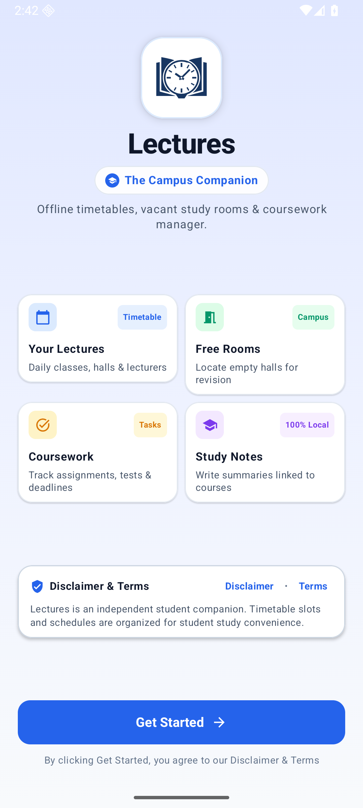
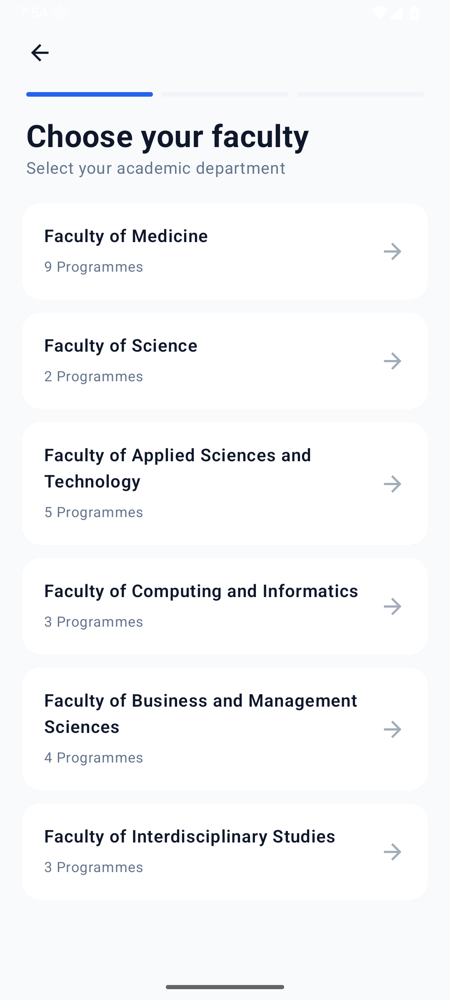
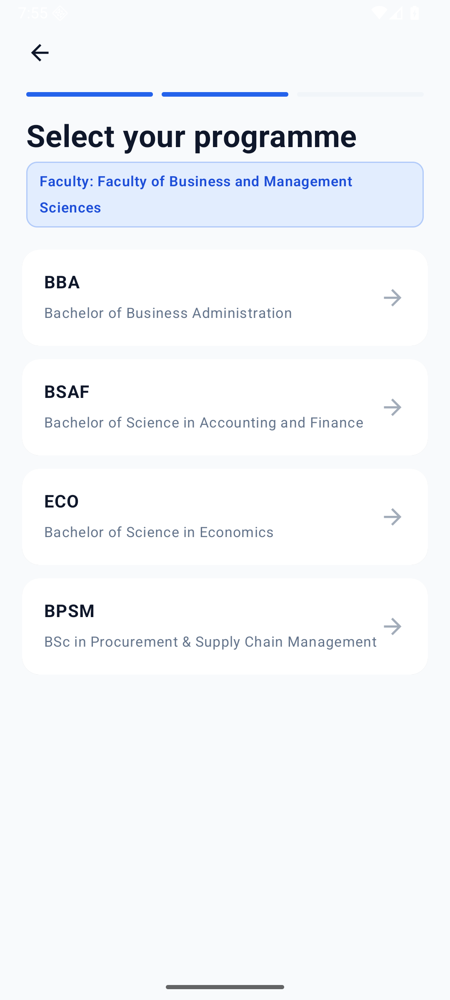
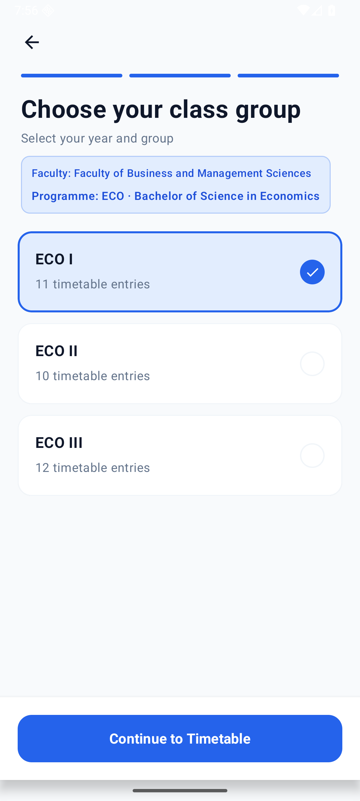
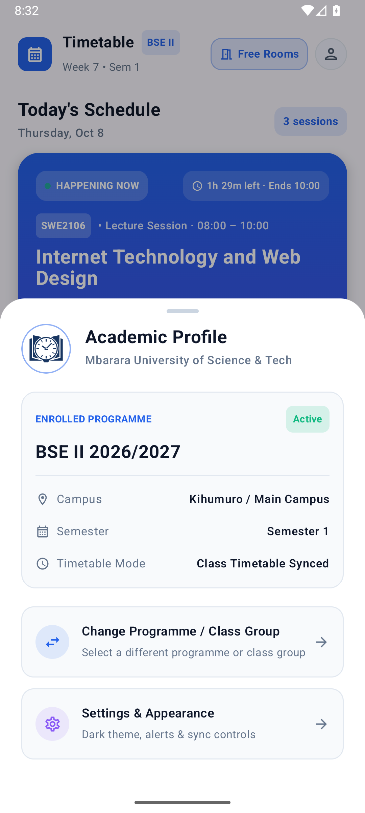
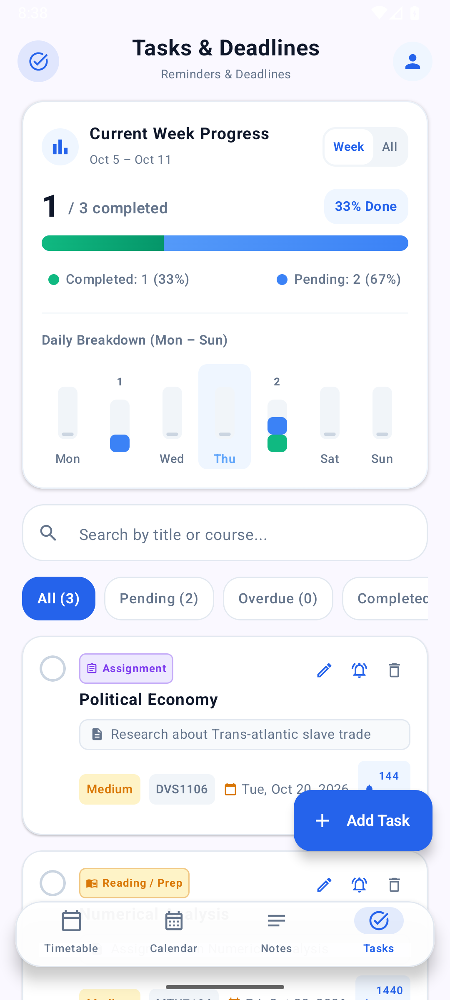
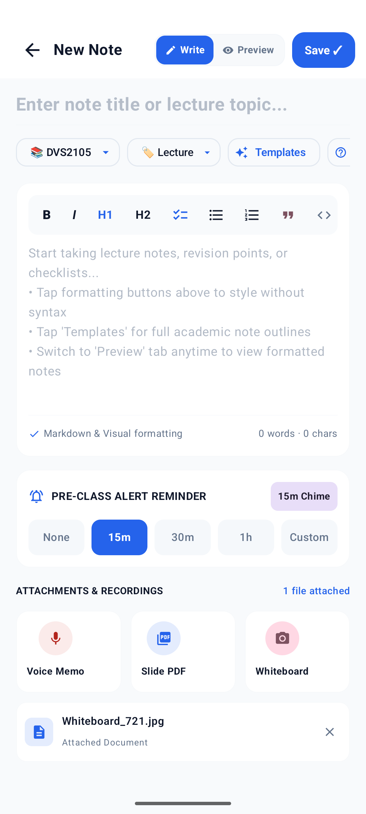
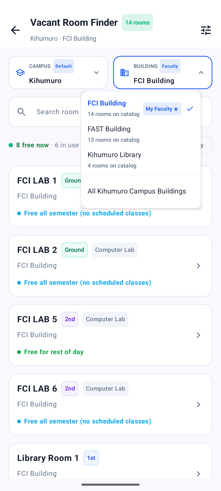
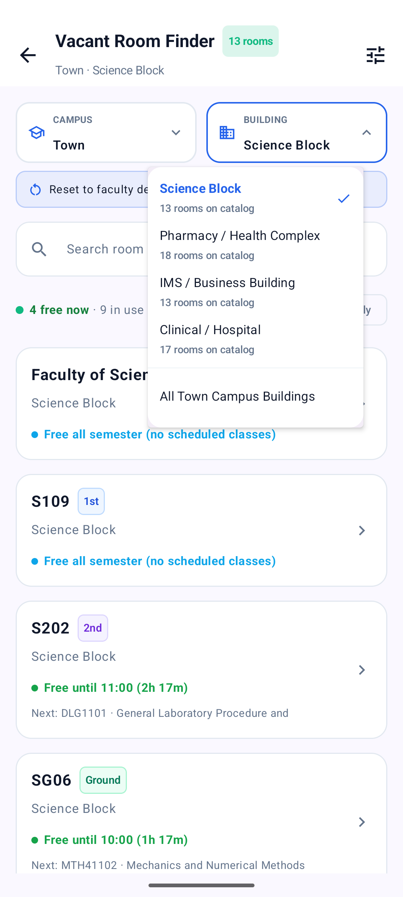

# Lectures — App Screenshots

All screens from the current release, grouped by feature area.

## Onboarding

*Welcome screen — app identity, feature overview, and onboarding entry point.*

*Faculty selection — step 1 of 3: six faculties with programme counts.*

*Programme selection — step 2: degree programmes within the selected faculty.*

*Class group selection — step 3: year group with live timetable entry counts.*

## Timetable & Profile

*Timetable — card-based daily view with a live "Happening Now" tracker: progress bar, elapsed/remaining time, venue, lecturer, and quick actions.*

*Academic profile — enrolled programme, campus, semester, and timetable sync status.*

## Productivity

*Tasks & deadlines — week progress, daily breakdown, priority filters, and course-tagged assignments.*

*Lecture notes — Markdown editor with Write/Preview toggle, course linking, templates, pre-class reminders, and attachments.*

## Vacant Room Finder

*Vacant Room Finder — Kihumuro campus, FCI Building: 14 rooms, 8 free now, with floor badges and per-room availability.*

*Vacant Room Finder — Town campus, Science Block: free-until times with the next scheduled class shown.*
